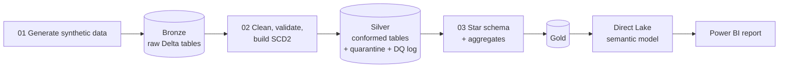

# ClaimStream: a P&C insurance claims platform on Microsoft Fabric

An end-to-end analytics project built on Microsoft Fabric: synthetic insurance data lands in a Lakehouse, moves through a bronze / silver / gold medallion architecture in PySpark notebooks, is served through a Direct Lake semantic model, and is reported in Power BI. Development happens in a Git-connected Dev workspace and is promoted to Prod with a deployment pipeline.

All data is synthetic and generated by the project's own notebook. No real customer data is used.

## What this project demonstrates

- Medallion architecture on a Fabric Lakehouse (Delta tables, PySpark)
- Data quality handling: rules, quarantine table, run-level DQ log, reconciliation assertions
- Slowly changing dimension (SCD Type 2) built from a change log
- Point-in-time join of claims to the policy version in force on the loss date
- Star schema, Direct Lake semantic model, DAX measures
- Git integration, branching and pull requests, and Dev to Prod promotion with a deployment pipeline

## Architecture

Environments: a **port-project** workspace connected to the `dev` branch of this repo, and a **port-prject-prod** workspace that receives content through a deployment pipeline. Changes go from `dev` to `main` by pull request.

## The data

The generator (notebook 01) is seeded, so every run produces the same data. It covers 2019-01-01 to 2026-10-29 for four lines of business: personal auto, homeowners, tenant, and small business.

| Bronze table | Rows | Notes |
|---|---|---|
| `bronze_customers` | 100,500 | 100,000 customers plus 500 deliberate duplicates |
| `bronze_policies` | 182,165 | change log: 140,000 policies plus 42,165 premium amendments |
| `bronze_claims` | 23,765 | |
| `bronze_claim_payments` | 37,528 | |
| `bronze_coverage_types` | 4 | reference table |

Five data quality problems are injected on purpose so the silver layer has something real to handle: duplicate customers, missing emails, lowercase province codes, claims reported before the loss date, and policies stored as a change log.

## Silver layer: cleaning and validation

| Rule | Rows affected | Action |
|---|---|---|
| Duplicate `customer_id` | 500 | keep one row per customer |
| Province code not upper-case | 2,012 | upper-cased |
| Missing email | 971 | kept, flagged `email_missing` |
| `reported_date` earlier than `loss_date` | 77 claims | quarantined |
| Payment whose parent claim was quarantined | 131 payments | quarantined |

- **`silver_quarantine`** holds every rejected row with a reason and the original record as JSON (208 rows in total).
- **`silver_dq_log`** records the count for every rule on every run, appended so history is kept.
- **`silver_policies`** is an SCD Type 2 table: `valid_from` (inclusive), `valid_to` (exclusive), `is_current`. Each policy has exactly one current version.
- The notebook ends with assertions that fail the run if anything is off: bronze rows must equal silver rows plus quarantined rows, every policy must have exactly one current version, and versions must have no gaps or overlaps.

## Gold layer: star schema

| Table | Grain |
|---|---|
| `gold_dim_date` | one row per day |
| `gold_dim_customer` | one row per customer (province, age band; no names or emails) |
| `gold_dim_policy` | one row per policy version |
| `gold_dim_coverage` | one row per coverage type |
| `gold_fact_claims` | one row per claim |
| `gold_fact_premium_monthly` | policy version x month |
| `gold_mart_loss_ratio_monthly` | month x coverage x province |

**Business rules** (defined at the top of notebook 03):
- Claims are joined to the policy version **in force on the loss date** (point-in-time join), so a premium change never rewrites history.
- Incurred for a closed claim is total paid. For an open claim it is the larger of its reserve and what has been paid so far. Outstanding is incurred minus paid.
- Earned premium is the annual premium pro-rated by the days each policy version was in force in each month.
- Loss ratio is incurred divided by earned premium, by loss month.

Expected row counts after a full run: 2,922 dates, 100,000 customers, 182,165 policy versions, 4 coverage types, 23,688 claims, 2,950,878 premium rows, and 2,940 mart rows.

## Semantic model and report

A Direct Lake semantic model sits on the gold tables. Relationships are many-to-one with single-direction filtering:

| From | To |
|---|---|
| `gold_fact_claims[loss_date]` | `gold_dim_date[date]` |
| `gold_fact_claims[customer_id]` | `gold_dim_customer[customer_id]` |
| `gold_fact_claims[coverage_code]` | `gold_dim_coverage[coverage_code]` |
| `gold_fact_claims[policy_version_id]` | `gold_dim_policy[policy_version_id]` |
| `gold_fact_premium_monthly[month_start]` | `gold_dim_date[date]` |
| `gold_fact_premium_monthly[coverage_code]` | `gold_dim_coverage[coverage_code]` |
| `gold_fact_premium_monthly[customer_id]` | `gold_dim_customer[customer_id]` (**inactive**, see limitations) |

`gold_mart_loss_ratio_monthly` is related to the date table only.

Measures include Earned Premium, Incurred, Paid, Outstanding Reserve, Claim Count, Loss Ratio, Average Severity, Exposure Years, Claim Frequency per policy-year, Average Report Lag, Open Claims, and a trailing-twelve-month loss ratio.

The report has two pages: **Portfolio Overview** (premium, incurred, loss ratio, severity, loss ratio by month and coverage and by province, incurred by cause of loss) and **Claims Operations** (open claims, outstanding reserve, report lag, claim frequency).

## Validation

- Every notebook ends with checks that fail loudly. Gold checks that the point-in-time join neither drops nor duplicates claims, that paid amounts reconcile to silver, and that earned premium matches an independent day-count calculation.
- The semantic model was cross-checked against an independent SQL query on the mart for one coverage and year. Earned premium and incurred matched.
- The same row counts were confirmed in Prod after deployment.

## CI/CD

1. Develop in the port-project workspace, connected to the `dev` branch with Fabric Git integration. Commit from the Source control panel.
2. Open a pull request from `dev` into `main`, review it, and merge.
3. Promote content from Dev to Prod with a **deployment pipeline**. Each notebook has a default lakehouse deployment rule pointing at the Prod Lakehouse.
4. Run notebooks 01, 02, 03 in Prod to build the tables. Deployment moves definitions, not data.
5. Rebind the Prod semantic model to the Prod Lakehouse by running a notebook using semantic-link-labs.

## Known limitations

- **Recent months look better than they are.** Claims are reported with a lag and the model has no provision for incurred-but-not-reported (IBNR) claims, so recent loss ratios are understated.
- **Inactive relationship and `USERELATIONSHIP`.** Relating the premium fact to the customer dimension caused an "ambiguous path" error in the model. I did not find the root cause. The relationship is inactive and the premium measures activate it explicitly with `USERELATIONSHIP`. Any new measure on the premium fact that should respond to province or age band needs the same wrapper, or it silently ignores those filters.
- **Direct Lake model rebinding.** After deployment the Prod model still pointed at the Dev Lakehouse and had to be rebound by hand.
- **Trial capacity.** Built on a Fabric free trial. Dev and Prod shared one capacity, which produced Spark concurrency errors until stray sessions were stopped. The Git repo stores item definitions only, so the data layer is rebuilt by running the notebooks.
- **Synthetic data.** Frequencies, severities, and loss ratios are illustrative and not calibrated to any real insurer.

## Not done yet

- Orchestration: notebooks are run manually in order. A Data Factory pipeline is the natural next step.
- Real-time ingestion of claim events into an Eventhouse.

## How to reproduce

1. Create a Fabric workspace and a Lakehouse. Attach it as the default Lakehouse for each notebook.
2. Import the three notebooks and run them in order: `01_generate_bronze`, `02_bronze_to_silver`, `03_silver_to_gold`.
3. Create a Direct Lake semantic model on the `gold_` tables, add the relationships and measures above, and build the report.
